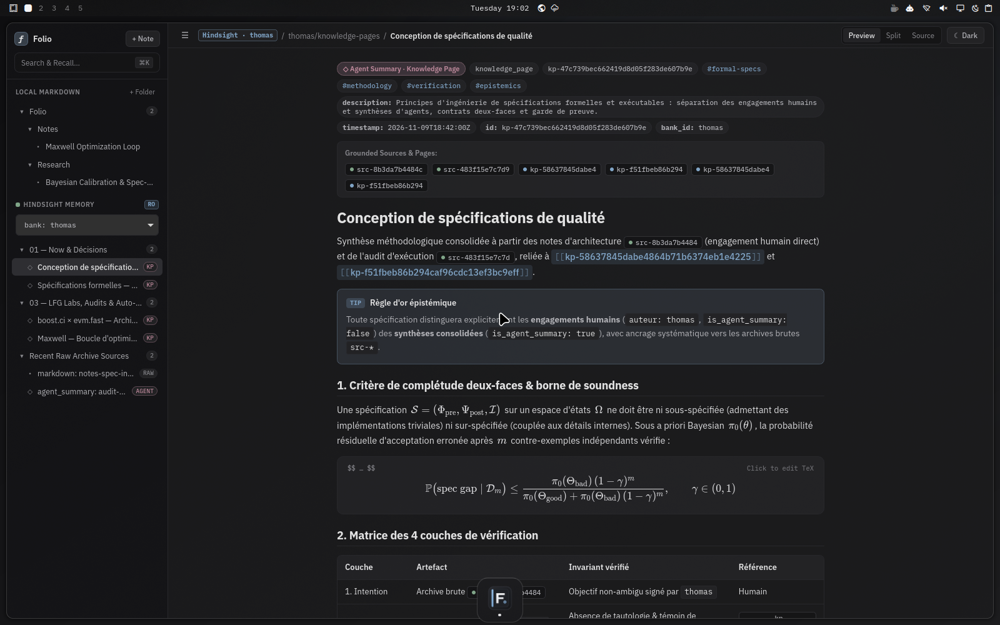
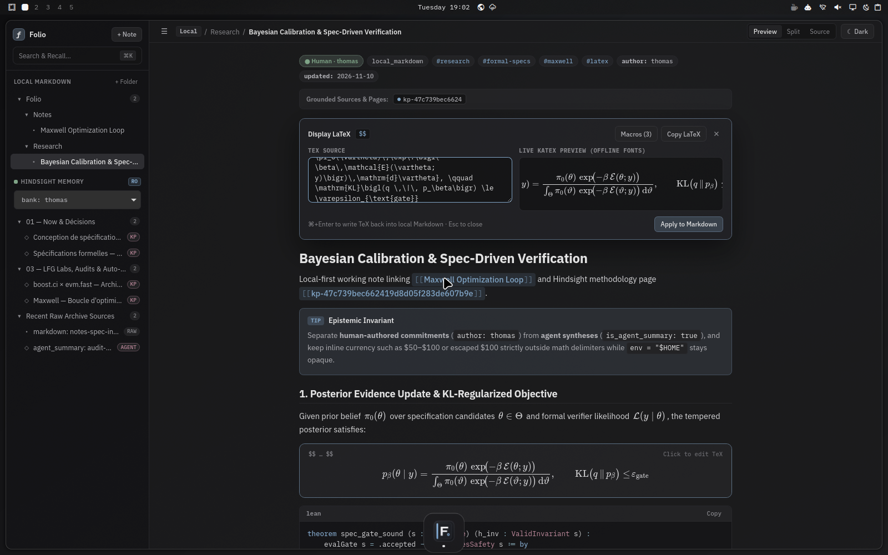
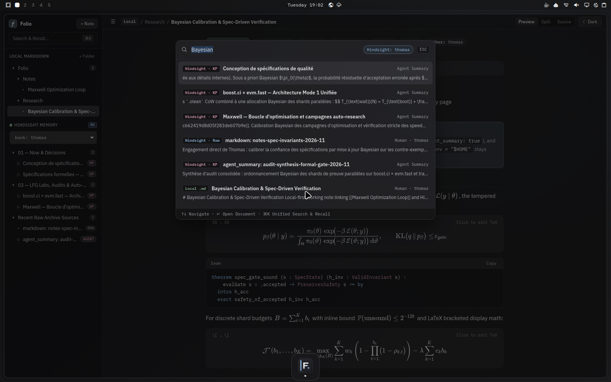
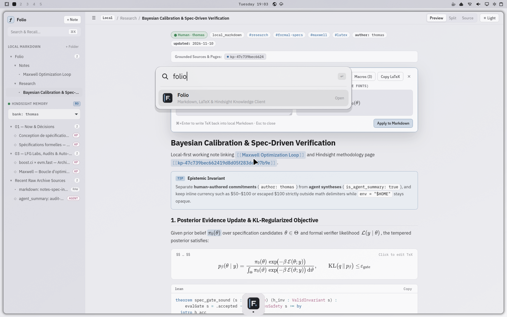

# Folio

**Folio** is a fast, zero-Electron native desktop client for **local Markdown workspaces**, **offline KaTeX mathematics**, and **Hindsight (`spark-memory`) knowledge hierarchies** — built on the exact **Orb** architecture (`GTK3 + WebKitGTK 4.1` on Linux/Wayland, `AppKit + WKWebView` on macOS, and a hardened loopback `folio-locald` daemon).

---

## Highlights

- **Zero Electron / Zero Cloud Lock-in**: Native system WebView (`webkit2gtk-4.1` on Linux, `WKWebView` on macOS) + SolidJS UI + local SQLite WAL + FTS5 cache.
- **First-Class Offline LaTeX (`KaTeX`)**:
  - Bundled `.woff2` KaTeX fonts (zero network/CDN requests).
  - Strict Markdown + math parser supporting `$...$`, `\(...\)`, `$$...$$`, and `\[...\]` while leaving `$100` currency, inline `` `code` ``, fenced blocks, and escaped `\$` untouched.
  - Click any rendered equation to open the **inline TeX editor & live preview** with custom per-workspace macro definitions (`\R`, `\E`, `\norm`, etc.), `Copy TeX`, and lossless delimiter-preserving write-back.
- **Unified Multi-Source Knowledge Workspace**:
  1. **`local-fs`**: Local `.md` directories (`~/Notes` + mounted folders) with YAML frontmatter, `[[wikilinks]]`, backlinks, and atomic temp-file + `os.replace` writes.
  2. **`hindsight`**: First-class `spark-memory` / `https://memory.thomas.md` integration (`thomas` bank + multi-bank switcher) with recursive `kp-*` page trees, human-authored vs. agent-synthesized provenance badges, clickable `kp-*` / `src-*` grounding chips, hybrid semantic recall (`Cmd+K`), and read-only safety mode (`FOLIO_HINDSIGHT_READONLY=1`).
  3. **`notion` (optional)**: Read/sync adapter via official Notion API v1 (`NOTION_API_KEY`) converting pages, equations, callouts, tables, and code blocks into clean Markdown + LaTeX.
- **Seamless `m2air` / `omarchnix` Integration**:
  - Translucent RGBA frosted-glass chrome (`opacity = "0.88 0.88"`, `rounding = theme.ui.rounding`, `border_size = theme.ui.borderSize`).
  - Live `starship-subtle` Dark & `starship-subtle-light` Light mode synchronization (`omarchnix theme toggle` + `prefers-color-scheme`).
  - Wayland HiDPI (`96.0` DPI fix), `GTK_USE_PORTAL=1`, `fcitx5` `us(intl)` dead-key IME safety (`event.isComposing`), and `Super -> Meta` shortcut forwarding (`Cmd+K`, `Cmd+N`, `Cmd+S`, `Cmd+\`, `Cmd+Shift+E`, `Cmd+Shift+L`).
  - Apple Silicon M2 AGX (`aurora` DRM) DMA-BUF priority (`/run/opengl-driver` prepended in wrapper & devShell), bounded WebKitGTK memory pressure (`512 MiB` soft limit, `DOCUMENT_BROWSER` cache model), immutable hashed asset caching, and race-free SSE desktop events (`/__folio_events`).

---

## Screenshots (`omarchnix` + Hyprland Wayland)

| Hindsight Knowledge Page (`starship-subtle` Dark) | Live Inline LaTeX (`KaTeX`) Equation Editor |
| :---: | :---: |
|  |  |
| **`Cmd+K` Unified Hybrid Search & Recall** | **Light Mode (`starship-subtle-light`) + Dock & Spotlight** |
|  |  |

---

## Repository Layout

- `linux_shell/` — Native GTK3 + WebKitGTK 4.1 Wayland shell (`main.c`, `Makefile`)
- `macos_shell/` — Native AppKit + WKWebView macOS shell (`main.swift`)
- `daemon/` — Hardened loopback `folio-locald` daemon (`SQLite WAL + FTS5`, `local-fs`, `hindsight`, `notion`, OS keyring / `0600` secret resolution)
- `ui/` — SolidJS + TypeScript + Vite frontend (offline KaTeX, Mermaid, Prism + Lean 4 + Nix, inline equation editor, `Cmd+K` recall modal)
- `assets/` — Scalable SVG icon + Freedesktop `.desktop` entry (`StartupWMClass=folio`)
- `nix/` — Nix package derivation, Home Manager / NixOS modules, and QEMU/KVM VirGL Wayland visual test

---

## Building & Running with Nix

```bash
# Build Folio desktop binary
nix build .#folio

# Run self-tests (Linux shell + loopback daemon)
./result/bin/folio --self-test
./result/bin/folio-locald --self-test

# Run full flake checks (daemon unit tests + UI math parser tests + package build)
nix flake check
```

---

## Declarative `omarchnix` & `nixos-config` Integration (`m2air`)

### 1. Add `folio` flake input (`omarchnix/flake.nix` or `nixos-config/flake.nix`)

```nix
inputs.folio = {
  url = "github:Th0rgal/folio";
  inputs.nixpkgs.follows = "nixpkgs";
};
```

### 2. Overlay & System Package (`hosts/m2air/default.nix`)

Add `folio.overlays.default` to `nixpkgs.overlays` and `folio-desktop` (or `folio`) to `environment.systemPackages`:

```nix
environment.systemPackages = with pkgs; [
  orb-desktop
  folio-desktop
];
```

### 3. Hyprland Lua Window Rule & Keybind (`omarchnix/home/hyprland.nix` or `home/thomas.nix`)

Import `folio.homeManagerModules.default` and enable `programs.folio`:

```nix
programs.folio = {
  enable = true;
  hindsight = {
    apiUrl = "https://memory.thomas.md";
    defaultBank = "thomas";
  };
  hyprland = {
    enable = true;
    # Note: CTRL + SUPER + F is fullscreen in omarchnix, so Folio defaults to CTRL + SUPER + N (configurable)
    launchBind = "CTRL + SUPER + N";
  };
};
```

### Credentials

Folio never stores tokens in SQLite or Nix store paths. Provide credentials at runtime via:
- `libsecret` / `gnome-keyring` (`secret-tool store --label="Folio Hindsight" service folio account hindsight_api_key`)
- macOS Keychain (`security add-generic-password -s folio -a hindsight_api_key -w ...`)
- `sops-nix` `0600` secret files via `HINDSIGHT_API_KEY_FILE` / `SPARK_MEMORY_API_TOKEN_FILE` / `NOTION_API_KEY_FILE`.
